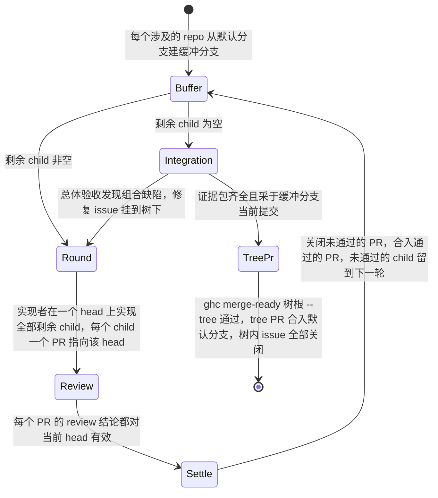

# delivering-issues

本 skill 把一组 issue 推进到「代码进入默认分支、issue 已关闭」，或以有据可查的 no-code 理由关闭。它只规定编排：谁实现、谁审、何时合并、设计缺口怎么裁、记录留在哪里。PR 正文与证据形式按 `skill://writing-pr`，review 的 gate 与裁决按 `skill://review-pr`，讨论位置按 `~/.claude/rules/git.rule.md` 的「GitHub issue / PR routing rule」，完整抓取、合并前提与缓冲分支命名用 `skill://gh-contract` 的 `ghc`，运行验证强度按 `~/.claude/rules/runtime-verification-required.rule.md`。

issue 从哪来——`writing-complex-issues` 产出的树、手写的列表、导入的工单、上个会话遗留——不改变步骤；每一项都按「逐项分类」核实实时状态，不因来源假定它尚未完成或必然需要代码。issue 正文里的依赖与编排只是参考：一棵树的 child 在同一轮一起实现，不按 issue 写的先后串行。

## 分工

用户要求按本流程交付时，下表分工生效。这是用户对 `~/Ext/code/omomp/omp-config/agent/APPEND_SYSTEM.md` 默认分工的显式改写（依据其「User instructions take precedence」），只作用于这张表，其余规则照常适用。编排者自行匹配到本 skill 不构成这一改写；那种情况下先向用户呈报计划，由用户要求执行（见「输入与启动」第 5 步）。子代理看不到对话、本 skill 和 appendix，每个 brief 都要写明这段分工（[references/briefs.md](references/briefs.md) 的共有块）。

角色只规定要求，不规定 agent 名或模型：派工时按本机当前可用的 agent 定义选择满足要求的那个。agent 名和模型名不写进 issue、PR 或任何 GitHub comment，除非它们本身就是该 issue 要改的对象。

| 角色 | 要求 | 负责 | 不做 |
|---|---|---|---|
| 编排者 | 当前会话 | 逐项分类；建缓冲分支；设计裁定；设计权威文件与 issue 契约的编辑；派实现、review 与总体验收；核实 gate 结论；关闭未通过的 PR、合并 PR；记录 | 实现代码与测试；替实现者定实现方案；问用户 |
| 实现者 | 每轮（树）或每个 issue（独立）新起一名：只凭 brief 从空白开始，不继承编排者上下文；在自己的工作目录写代码；本机允许写代码的最高能力档 | 本轮全部实现（含核心代码）、测试、按测试形态采集证据、开 PR、修复；按自己的 system prompt 安排下级 subagent | 编辑设计权威文件；合并；推进本轮之外的 issue |
| reviewer | 每个 PR 每个 HEAD 新起一名，用完即弃；只读代码 | 在一个 HEAD 上执行 `review-pr` Gate 1–5，把结论直接发到 PR thread | 改代码、补作者证据、合并 |
| 总体验收采集者 | 每次新起一名；不是本树任何一轮的实现者 | 在缓冲分支当前提交上逐行执行总体验收 issue 的验收表，报告编排者 | 改代码、写 GitHub（`ghc` 上传截图附件除外） |
| 顾问 | 只读讨论代理：一名保守立场（压测风险、找更省事方案），一名发散立场（重构问题、找实质不同方案）；取证用不写 repo 的探针代理 | 设计缺口的正反论证与事实取证 | 裁定、编辑文档 |

- APPEND_SYSTEM 里「亲自写核心、外围委派」等实现义务作用于实现者。编排者不以「核心应由我写」为由收回实现。
- **设计权威文件**：设计文档，以及设计文档或 umbrella 指定为契约源、且不在产品源码目录里的类型声明（例如 `spec/types/`）。只有编排者在裁定时编辑它们；issue 正文即使写着「组件内歧义由 child 在 PR 里写进所属章节」，实现者也改为上报编排者。契约源位于产品源码里时，编排者把裁定写进设计文档与 issue，类型改动由实现者实现。没有指定设计文档的 issue，issue body 就是契约，裁定改写 body。
- **reviewer 与 `review-pr` 的组合**：reviewer 同时是 `review-pr` 的主审和执行层，自己完成 Gate 5，不再派子代理，并把结论直接发到 PR thread（改写 `review-pr`「执行层不创建 GitHub 对象」的限制）。编排者保留两件事：核实已发布的发现，以及合并。
- 交付物只有设计权威文件的 issue，由编排者兼任实现者：亲自写文档与契约类型、开 PR（`writing-pr` 按 issue 类型选模板）；review 照常由新起的 reviewer 做。

## 验收只执行一次

每张验收表只执行一次，执行者与执行时机由 issue 的位置决定：

| 验收表 | 谁执行 | 在哪个提交上 | 强度 |
|---|---|---|---|
| 树内 child | 该轮实现者，`ghc ev run` 采集，`ghc ev publish <PR>` 发布 | 本轮 head | 按 child 声明的测试形态（`最薄入口`、`driver`、`集成` 或 `e2e`），不升级 |
| 总体验收 issue | 总体验收采集者 | 全部 child 合入后的缓冲分支当前提交 | `e2e` |
| 独立 issue | 实现者 | PR head | `e2e`（writing-issue 对不在树里的 issue 的要求） |

reviewer 在 Gate 4 判断证据是否真的观察到结果；怀疑证据时可以跑针对该疑点的探针，但不重跑整张验收表，探针结果也不替代作者证据。合并后不再重跑：合并提交的内容就是被验证的 head（树内）或被验证的 PR head 合入默认分支（独立 issue），默认分支在验证后前进时 `ghc merge-ready` 会因不可合并或 HEAD 变化而拒绝。部署型 repo 在 repo 交付规则允许的环境里部署被验证的提交再采集；规则只允许从默认分支部署时，作为外部阻塞报告用户。

## 输入与启动

| 项 | 取得方式 |
|---|---|
| 执行清单 | 用户给出的 issue 列表或树根。树根下的 child 都属于该树；独立 issue 按用户给的顺序，没给时按编号 |
| 每个 issue 的目标 repo 与默认分支 | issue 所在 repo；issue 正文指明代码在别处时以正文为准 |
| 设计权威 | issue 必读章节、umbrella 契约、目标 repo 的设计文档与契约类型；都没有时是 issue body |
| 设计记录位置 | 有 parent/umbrella 时用它；没有时用当前 issue |
| 策略原文 | `~/Ext/code/omomp/omp-config/agent/APPEND_SYSTEM.md` 全文，与当前 system prompt 的指定区块（见 briefs.md） |

1. 用 `ghc fetch` 完整抓取树根与清单里每个 issue（body、全部 comment、图边与关联 PR），读各目标 repo 的 `AGENTS.md` / `CLAUDE.md` / rules，和各 issue 必读的设计章节全文。
2. 对每个 issue 做「逐项分类」。
3. `todo` 建全套：每棵树一项「树 <链接>」（完成于 tree PR 全部合并），每个独立 issue 一项。
4. 写中心计划（结构见「记录与恢复」），写完读回一次。
5. 用户只要求「安排」「计划」，或本 skill 是编排者自行匹配到的，停在这里汇报计划，等用户要求执行；用户已要求按本流程执行就直接开始。开始之后不再向用户提问。

编排者和所有子代理都不在隔离工作区或编排者的工作 checkout 里改 repo，而是各自在 `/tmp/delivering-issues/<owner>-<repo>-<编号>/<角色>-<轮次>` 下基于远端提交另建 clone 或 worktree。这样工作 checkout 保持原样，实现者尚未推送的工作也留在一个可查的路径上。

### 逐项分类

| 实时状态 | 处置 |
|---|---|
| 总体验收 issue（`类型：总体验收`） | 不进入实现轮，按「树：总体验收与合入默认分支」处理 |
| 树内 child，已有合入缓冲分支的 PR | 已合入，不再进入实现轮 |
| 树内 child，open，没有合入缓冲分支的 PR | 进入下一轮 |
| 独立 issue，open，没有关联 PR | 派实现者 |
| 独立 issue，open，已有本任务能维护的 PR（本流程所开，或其作者明确交给本任务） | 实现者沿用该 PR |
| open，已有本任务无权维护的 PR（他人仍在推进，或无推送权限） | 不改动其 branch；新 PR 另开，编排者在旧 PR 留 comment 说明原因并链接新 PR |
| 已由合并的 PR 关闭 | 完成 |
| 已关闭，有持久的 no-code 理由 | 核实理由仍成立即完成；不成立则重新打开，再按本表分类 |
| 已关闭，没有合并 PR 也没有理由 | 重新打开，再按本表分类 |
| open，已满足、重复、无效或失去意义 | 编排者取证，按 `review-pr` Gate 6 在 issue 上发布持久理由后关闭 |

实现中实现者报告某个 issue「无需代码」或「需要拆分」时，编排者核实后分别走 no-code 关闭，或用 `writing-issue` 写出新 issue（树内的挂到树下，并加入总体验收 issue 的组合对象与依赖）、改写当前 issue 的范围，让新 issue 进入下一轮。

## 树：按轮交付

缓冲分支名由 `ghc` 决定：`tree/<树根 owner>-<树根 repo>-<树根编号>`，树涉及的每个 repo 各一条，从默认分支当前提交建出。child PR 只合入缓冲分支；只有 tree PR 把缓冲分支合入默认分支。GitHub 不为合入非默认分支的 PR 关闭 issue，所以 child 在 tree PR 合并时才关闭。

### 1. 实现一轮

本轮集合是树内尚未合入缓冲分支的全部 child（不含总体验收 issue）。派一名新的实现者负责整轮（模板「树的一轮」），不按 child 拆给多名实现者：同一轮的代码要在一个 head 上一起测试，集成与修复只有一个负责人；实现者可以按自己的 system prompt 再派下级 subagent。

实现者在每个涉及的 repo 基于缓冲分支当前提交建一个工作分支，一起实现本轮全部 child，提交后：

1. 对本轮每个 child 按 `ghc ev plan <child>` 采集证据，全部在这一个 head 上；`ghc ev check <child>` 退出码 0 的 child 才开 PR。证据补不齐的 child 不开 PR，在报告里写明缺哪几行、为什么。
2. 为每个要开 PR 的 child 推一个分支 `<缓冲分支>-c<child 编号>-r<轮次>`，全部指向同一个 head，开 PR：base 是缓冲分支，正文第一行 `Closes <child>`，按 writing-pr 写实现说明。每个 PR `ghc lint <PR>` 与 `ghc ev publish <PR>` 退出码 0。
3. 报告编排者：head、每个 child 的 PR 链接与证据包链接、未开 PR 的 child 及原因。之后保持在线，等编排者通知。

### 2. review

编排者用 `ghc fetch` 的实时 payload 核对每个 PR：open、base 是缓冲分支、HEAD 与报告一致，再为每个 PR 同一批派一名新的 reviewer（模板「reviewer」），全部钉死同一个 head。review 期间实现者不推送。

### 3. 结算

每个 PR 的 review 结论都对当前输入有效后，编排者逐个核实已发布的发现（`review-pr`「消化报告」，契约争议按「契约问题与设计缺口」分类），被驳回或改判的发现在 PR thread 发 comment 写明依据（模板「驳回或改判 review 发现」）。驳回导致 review 失败的发现后，该 PR 重新派一名新的 reviewer：首个失败后的 gate 从未审过。

然后对每个 PR 跑 `ghc merge-ready <PR> --issue <child> --head <head>`：

- **通过**：退出码 0。
- **未通过**：其余情况，包括证据补不齐没开 PR 的 child。

合入顺序有讲究：同一个 head 的 PR 中任意一个合入后，GitHub 把其余指向同一 head 的 PR 一起标记为已合并。所以编排者先关闭全部未通过的 PR（comment 写明失败的 gate 或证据行并链接 review），再在每个 repo 用 `gh pr merge <N> --merge --match-head-commit <head>` 合入一个通过的 PR，之后用实时 payload 确认同 repo 的其余通过 PR 都显示 MERGED。一个都没通过的 repo 不合入，缓冲分支不动。

未通过的 child 进入下一轮：下一轮实现者在新的缓冲分支提交上（已含本轮合入的代码，包括与未通过 child 共处一个 head 的代码）修复它们，开新的 PR，链接上一轮被关闭的 PR 与其 review。循环到剩余集合为空，轮数没有上限。

### 4. 总体验收与合入默认分支

1. 剩余集合为空、且没有尚未进入缓冲分支的设计 commit 后，派一名新的总体验收采集者（模板「总体验收」），在各 repo 缓冲分支的当前提交上用 `ghc ev run <总体验收 issue> --checkout <各 repo 检出>` 逐行采集；编排者跑 `ghc ev publish <总体验收 issue>` 发布证据包。
2. 发现组合缺陷时，用 `writing-issue` 开修复 issue 挂到树下，加入总体验收 issue 的组合对象与依赖，进入下一轮；修复合入后在新的缓冲分支提交上重新采集总体验收。
3. 证据包齐全后，编排者在每个 repo 开 tree PR：head 是缓冲分支，base 是默认分支，正文按 writing-pr「tree PR 模板」，第一行 `Tree <树根>`，逐行 `Closes` 该 repo 里全部未关闭的树内 issue（树根所在 repo 还要关闭树根）。`ghc lint <tree PR>` 退出码 0。
4. `ghc merge-ready <树根> --tree` 逐项列出未满足的前提；按它合并：先合并树根之外的 repo 的 tree PR，最后合并树根所在 repo 的那个（它关闭树根）。全部合并后用实时 payload 确认树内 issue 全部 CLOSED。

## 独立 issue

不在任何树里的 issue 逐个交付，前一个合并后才开始下一个。

1. 派新的实现者（模板「独立 issue」）：从默认分支建分支实现，`ghc ev run` 按 e2e 采集，`ghc ev check <issue>` 退出码 0 才开 PR；PR base 是默认分支，第一行 `Closes <issue>`；`ghc lint <PR>` 与 `ghc ev publish <PR>` 退出码 0。
2. 编排者核实实时 payload 后派新的 reviewer；review 期间实现者不推送。
3. 结算同树的第 3 步：失败的发现交给实现者在原 branch/PR 修复，在新 HEAD 上重新采集、`ghc ev publish`，按 writing-pr 发重试评论；HEAD 一变，旧的 review 结论失效，派新的 reviewer。`ghc merge-ready <PR> --issue <issue> --head <HEAD>` 退出码 0 后，编排者用 `gh pr merge <N> --merge --match-head-commit <HEAD>` 合并，确认 issue 经 closing link 关闭。
4. PR 不可合并（冲突或落后于强制要求）时，实现者整合默认分支，产生新 HEAD，重新采集与 review。

## 契约问题与设计缺口

实现者、reviewer、总体验收采集者上报的契约问题，以及编排者核实 gate 发现时遇到的契约争议，先由编排者分类：

| 类 | 判据 | 处置 |
|---|---|---|
| 契约已答 | 现有章节的文字直接决定结果 | 引章节回复提问者；review 照此判 |
| 输入越界 | 现象只在契约定义域外出现 | 引依据驳回候选缺陷，不要求改代码 |
| 实现缺陷 | 契约清楚，实现不符 | 按 review 失败处理：树内进入下一轮，独立 issue 由实现者修 |
| 验收方法不成立 | issue 的验收行在本层观察不到，或只能产出无意义证据（例如没有接入被测路径的 mock 计数） | 编排者修正 issue 契约：产品要求不变，只改观察方法；验收行写着的义务照原样保留。本层能观察的部分改成有意义的观察；本层观察不到的部分移给能观察它的 issue（树内通常是总体验收 issue）并当场写进其 body，没有这样的 issue 就用 `writing-issue` 新建 |
| 设计缺口 | 契约沉默或自相矛盾，不同选择会改变可观察结果或迫使另一实现单元同步改变 | 属于后果性决策，走下面的裁定流程 |

裁定流程：

1. 告诉实现者暂停依赖此点的部分、继续无争议的部分；不在本地加 shim、不扩展或复制契约类型。
2. 读拥有该语义的文档及受影响的类型、例子全文。事实不明时派探针经真实入口跑；同一批派保守与发散两名顾问，给实际分歧、候选方案、文件路径与自己的初判，逐条追问异议。
3. 当场裁定。顾问意见只是输入；不为迁就已有实现而放宽契约。
4. 在编排者自己的干净 worktree 里修改设计权威文件：编辑任何设计文档前先读完整份文档（含工具折叠或截断的行）；直接替换对应章节，不留新旧并存；核对关联文档语义一致。树内的裁定提交到缓冲分支，正在进行的一轮由实现者把工作分支整合到新的缓冲分支提交上；独立 issue 的裁定提交到该 PR 的 branch（先让实现者推送并暂停推送，编排者推上只改设计权威文件的 commit，实现者拉取后继续，PR 实现说明注明该 commit 由编排者提交及裁定链接）。repo 规则不允许编排者推送这些分支时，按外部阻塞报告。
5. 在设计记录位置发设计修正 comment（写法按 `writing-complex-issues` 的 [comment-layers.md](../writing-complex-issues/references/comment-layers.md)）：裁定、依据、被否方案及理由、commit 链接、已知的暂时失败。同步替换活跃正文里受影响的内容：umbrella 的契约区块；裁定给某个 issue 新增义务或改变验收时，该 issue 的预期结果、范围与验收表；后续 issue 中指向被取代条款的契约引用，改指新的设计修正 comment。每个被改的 issue 发决策 comment。
6. 通知实现者同步后继续（模板「设计裁定通知」）；依赖旧契约的 review 结论失效，新 head 推出后重新派 reviewer。

## 有效性

review 结论 comment 第一行由 `ghc gate header` 生成，记下 HEAD、base 分支、issue 正文修订与设计权威；`ghc gate list <PR>` 与 `ghc merge-ready` 据此判断它是否仍有效，HEAD、base、issue 正文修订任一改变即失效。PR 正文与作者证据、编排者在 PR thread 的裁定与驳回、适用的决策 comment、设计权威版本，由编排者在结算前核对；任一改变后重新派 reviewer。

## 记录与恢复

- **权威状态都在 GitHub 与 git 上**：issue 与 PR 状态、PR thread 里的 review 结论与重试评论、设计记录位置的裁定 comment、总体验收 issue 上的证据包、缓冲分支与默认分支上的提交。每次状态转移都先落到这些地方。
- **中心计划**（`local://<清单名>-delivery-plan.md`）是编排者的本地索引与意图，开头写明它不替代上述权威。内容：分工与不变边界；每棵树的缓冲分支、当前轮次、每个 child 的状态（剩余 / 本轮 PR / 已合入及 PR 链接）；独立 issue 表；恢复点（当前轮次或当前 issue、实现者 agent id 与工作目录、本轮 head、在跑的 reviewer、尚未进入缓冲分支或默认分支的设计 commit 与其 comment、下一步）。每次状态转移后，在权威来源确认过再更新。
- **`todo`**：每棵树、每个独立 issue 一项，完成才标 done。
- **同会话恢复**（compaction 后）：读中心计划，用 `ctx list` 看 agent 名单，再用实时来源查缓冲分支提交、本轮 PR 的 HEAD 与状态、issue 状态；以权威来源为准修正计划后继续。
- **新会话恢复**：上个会话的子代理随其会话进程结束。用户明确说明上个会话已结束，或能查到其进程已退出时：逐项读实时状态（缓冲分支、合入缓冲分支的 PR、open PR 与其 review 结论、总体验收证据包、裁定 comment）重新分类，写新的中心计划；本轮有 open PR 时派新的实现者接手同一批 PR 与 head（模板「接手」）。二者都不成立时，旧会话可能仍在运行，不派接手，作为所有权阻塞报告用户。接手者推送被拒时停下报告，不强推。

## 不停顿

- 不向用户提任何问题。可以查的就查，设计问题由编排者裁定。
- 需要操作员独有的事实（业务动机、授权范围）而请求、历史与 repo 证据都给不出时，选能保住既定目标、又不扩大授权的方案，作为裁定记录下来；不存在这样的方案时，它是缺失的前提，按下一条作为阻塞报告。
- 别的 skill 或工具与本 skill 的分工冲突时（例如要求问操作员，或要求独立复跑验收），按本 skill 执行，不停下来问，也不等待。
- 依赖外部 owner 的状态（别的 repo、第三方、IaC）时，按全局规则向源头提请求并等待结论；这是真正的外部阻塞。GitHub 认证失效、权限不足、网络不可达、所有权冲突、缺失前提也是。只有这类阻塞才向用户报告，并写明已尝试的途径。
- 子代理的结果会自动送达；没有可做的事时才 `wait`。

## 反模式

- 让编排者自己写实现或测试；派实现者时让它继承编排者的上下文。
- 把一棵树的 child 拆成多轮串行实现，或拆给多名实现者各自开 head；按 issue 正文里的编排顺序串行。
- 树内 child 的 PR 合入默认分支；先合入通过的 PR、再关闭未通过的 PR（同 head 的未通过 PR 会被 GitHub 一起标记为已合并）。
- 同一张验收表执行两次：独立复跑、合并后重跑、把 child 的测试形态升级成 e2e。
- 在 issue、PR 或 comment 里写 agent 名、模型名或编排细节。
- brief 里只给策略文件路径却不附原文，或凭记忆改写「原文」；brief 里限制子代理的报告长度。
- 在已失效的 review 结论上合并；驳回发现后把失败的 review 当通过；续用上一轮的 reviewer；让 reviewer 补作者证据或再派审查子代理。
- 把隔离 worktree 或工作 checkout 的现状当成 PR HEAD；用缓存判断 PR 状态；在隔离工作区或编排者的工作 checkout 里改 repo。
- 把顾问意见当裁定；只在消息里给出新的契约语义，却不写进设计权威与记录位置；裁定给 issue 加了义务却不改写它的 body。
- 把中心计划或 `ctx` 当权威；因为另一个 skill 的写法和本流程对不上就去问用户。
