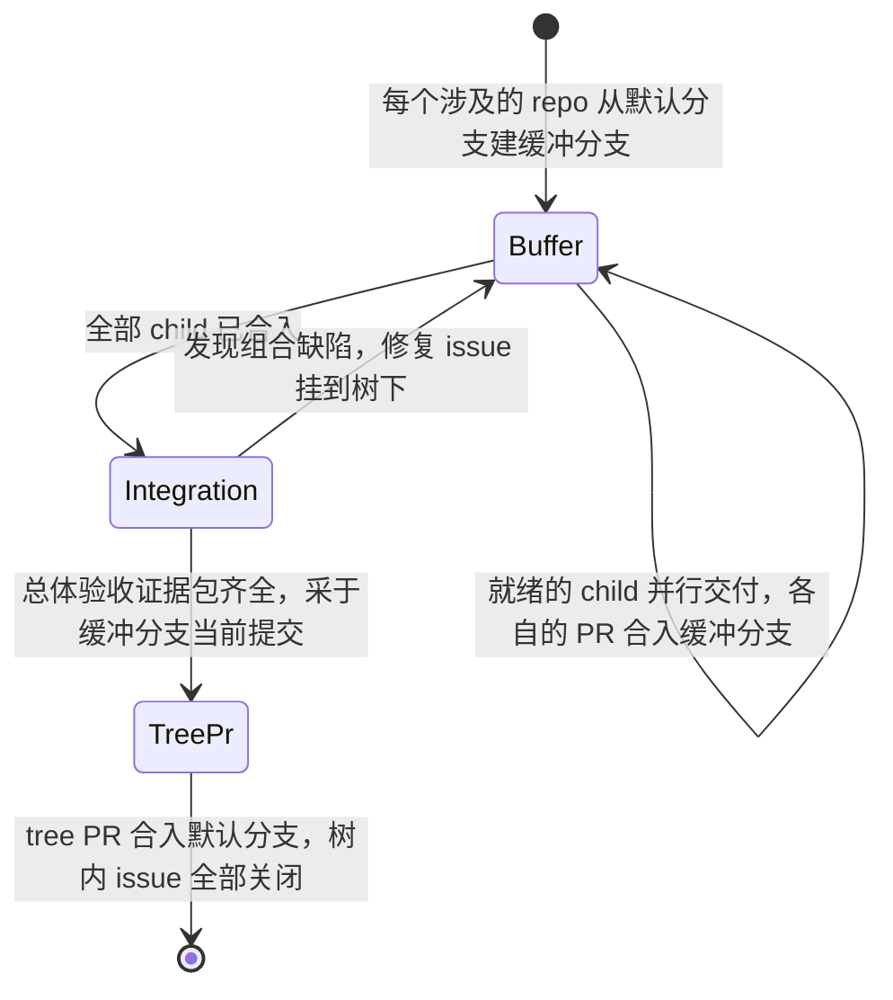

# delivering-issues

本 skill 规定一个会话用子代理把 issue 推进到「代码进入默认分支、issue 已关闭」时怎么做：怎样拆、怎样并行、怎样测试、怎样合并。

issue 写什么、PR 交什么、证据与合并前提怎样判定，在 `skill://writing-issue`、`skill://writing-complex-issues`、`skill://writing-pr`、`skill://review-pr` 和 `skill://gh-contract`，对任何执行方都一样。不经本会话派工的执行方只遵守那些契约，不读本 skill。

## 会话持有 issue

- 接到 issue 的会话自己读完它：`ghc fetch` 落盘后读全文、全部 comment、契约引用和必读章节。计划、切分、整合、证据和 PR 都由会话负责。
- 不把一个 issue 整个交给一个子代理。交给子代理的单位是切片。
- 只有改动很小才不拆：一处连贯的改动，落在少数几个互相紧耦合的文件上，拆开后切片要互相等对方的结果。这时会话自己写。其余情况都切片并行。
- 用户只要求安排或计划时，汇报计划后停下；要求交付就直接开始。

## 开工前：核对状态

每个 issue 先按实时状态分类，不因来源假定它尚未完成或必然需要代码：

| 实时状态 | 处置 |
|---|---|
| open，没有 PR | 进入交付 |
| open，已有本会话能维护的 PR（本会话所开，或作者明确交出） | 沿用该分支与 PR |
| open，已有本会话无权维护的 PR | 不改它的分支；另开 PR，并在旧 PR 留 comment 说明原因、链接新 PR |
| 树内 child，PR 已合入缓冲分支 | 已合入，等 tree PR |
| 总体验收 issue | 不实现，按「树」处理 |
| open，但已满足、重复、无效或失去意义 | 取证后按 `review-pr`「关闭资格」在 issue 上发布理由并关闭 |
| 已关闭，没有合并的 PR 也没有理由 | 重新打开，再按本表分类 |

实现中发现某个 issue 无需代码或需要拆分时，同样先取证：前者走 no-code 关闭；后者用 `writing-issue` 写出新 issue 并改写原 issue 的范围，树内的新 issue 挂到树下、加入总体验收 issue 的组合对象与依赖。

## 开工前：证据计划

写第一行代码之前，对每个要交付的 issue（树还包括总体验收 issue）定好证据从哪里采集：

1. 跑 `ghc ev plan <issue>`：列出每条预期结果的类型、对应的证据模板，以及按面要交的步骤。
2. 逐条结果定下：从哪个真实入口观察；在哪个环境；需要哪些前置（部署目标、依赖服务、数据、凭据、登录态）；由哪个切片交出这个入口。
3. `[改]` 与 `[保持]` 结果的改动前观察现在就在 base 提交的干净检出上采。它要重现 issue 现场里的那一幕；重现不了，说明现场或结果与事实不符，按「契约问题」处理。
4. 某条结果在本 issue 这一层没有入口，或环境不可达，现在就按「契约问题」处理，不留到实现之后。

证据计划约束切分：每条结果的入口都要有切片负责交出，采集所需的环境在实现期间备好。具体用什么输入、读哪个数在实现完成后定（`skill://writing-pr`「证据」）。计划记在会话的本地计划里，不写进 issue。

## 切片

- **按归属切。** 每个文件、每项状态恰好属于一个切片。两个切片要改同一个文件是切错了：重新划归属，不让它们各改各的再解冲突。
- **接口先定。** 切片之间的接口（类型、函数签名、错误分类、数据形状）在派出前定下，写进每个相关切片的任务。issue 的决策表和契约引用已经钉住的照用；issue 留给实现者的单元内接口，由会话现在定。
- **同时派出。** 切片各自在隔离的工作区里做。别的切片都要用的那一小段（共享类型与接口的落地）先由会话写完提交，其余切片从这个提交出发同时派出。
- **任务自足。** 子代理看不到对话和本 skill。任务写明：所属 issue 的链接、本切片的目标、它拥有的文件清单、要遵守的接口和契约条款所在位置、不做的事。
- **切片不做的事。** 不跑 repo 的构建、lint 和测试套件，不采集证据，不推送，不开 PR，不写 GitHub，不改清单之外的文件。接口或契约不够用时报告会话，不在本地扩展或另立副本。
- **会话整合。** 全部切片回到 issue 的分支后，由会话整合、提交。

## 多个 issue：按依赖并行

- **就绪。** 一个 issue 的 `Depends on` 所指的 issue 都已合入它的 base（树内是缓冲分支，独立 issue 是默认分支），或它没有依赖。
- **就绪的同时做。** 所有就绪的 issue 一起进行，各有自己的分支（从 base 当前提交建）、检出和 PR，它们的切片一起派出。一个 issue 合入后，被它解除阻塞的 issue 立即开工。
- **依据。** 树按树根的依赖图和各 child 的「依赖关系」；用户给的平铺列表按各 issue 的「依赖关系」，没有写依赖的互相独立。
- **文件不重叠。** 同时进行的两个 issue 要改同一个文件，说明它们之间有一条没写出的依赖：先做被依赖的一方，并把这条依赖补进 issue，树内同时补树根的依赖图。

## 测试与审查纪律：每样只跑一次

| 步骤 | 何时 | 在哪个提交上 |
|---|---|---|
| repo 的构建、lint、测试套件 | 一个 issue 的切片全部整合之后 | issue 分支 |
| review diff | 上一项通过并提交之后（此时不采集证据） | issue 分支当前 HEAD |
| issue 每条结果的证据 | review diff 通过之后 | 通过 review diff 的 HEAD，强度按 issue 的「测试形态」，不升级 |
| review 证据和 PR | `ghc lint <PR>` 与 `ghc ev publish <PR>` 通过之后 | PR 当前 HEAD |
| 总体验收 issue 每条结果的证据 | 树的 child 全部合入缓冲分支之后 | 缓冲分支当前提交 |

- 构建、测试与证据采集由会话执行；证据的逐条采集可以作为一个切片派出，采集计划仍是会话开工前定下的那一份。两类 review 均由不继承本会话上下文的只读 reviewer 按 `skill://review-pr` 执行。
- 切片不测，review 不重跑证据，合并后不重跑。
- 代码问题在 `review diff` 阶段一次审出、一次改完，定稿之后才采证据。在 `review 证据和 PR` 通过之前，HEAD 一变，已采的证据对新 HEAD 失效；一旦 `review 证据和 PR` 通过，PR 无条件合入中转分支，必定不再 review，也不要再重新采集证据。
- 实现途中要确认某段行为，跑针对这个疑点的一次探针，不跑整套。

## 合并纪律

- **一个 issue，一个分支，一个 PR。** PR 的 diff 只含本 issue 的改动；base 是树的缓冲分支（树内 child）或默认分支（独立 issue）。只有会话把切片整合进 issue 分支。
- **实现方不审自己的代码与 PR。** Review 分为两种，均由不继承本会话上下文的只读 reviewer 按 `skill://review-pr` 执行，review 期间不向该分支推送：
  1. **review diff**：切片整合、repo 检查通过并提交后立即进行，**此时不需要采集证据**。未通过则在原分支就地修代码、重跑 repo 检查，再送 `review diff`。
  2. **review 证据和 PR**：`review diff` 通过后采集证据、开出 PR，并在 `ghc lint <PR>` 与 `ghc ev publish <PR>` 通过后送审。reviewer 不重复确认 `ghc` 已经检查过的东西，重点看证据本身能否看出来解决了 issue，并把结论 comment 发到 PR thread。未通过则在原分支补采证据或修正 PR 正文，按 `writing-pr` 发重试评论，再送 `review 证据和 PR`。
- **核实发现。** 会话逐条核实 reviewer 提出的发现；驳回或改判的写明判定、依据和核实所用的命令与输出。
- **通过即无条件合并，永不重审、永不重采。** 一旦 `review 证据和 PR` 通过（`PASS`），该 PR **无条件合并到中转分支**（树内为缓冲分支 `tree/*`，独立 issue 为默认分支），**必定不再 review，也不要再重新采集证据**。别的 issue 合入或设计修正提交使 base 前进时，无冲突的直接合并；有冲突的把 base 整合进分支解完冲突后**直接合并，必定不再 review，也不要再重新采集证据**。`ghc merge-ready <PR> --issue <issue> --head <HEAD>` 退出码 0 后执行 `gh pr merge <N> --merge --match-head-commit <HEAD>`，合并后用实时状态确认。
- **后续问题必须开新的 sub-issue 和 PR。** `review 证据和 PR` 通过之后再发生什么问题（包括解冲突、合入中转分支或后续组合时暴露的缺陷、遗漏或回归），必须用 `skill://writing-issue` 开新的 sub-issue 和新的 PR，绝不在已通过的 PR 上重采或重审。单个 issue 的证据不证明组合，组合由总体验收负责。

### 树

- 缓冲分支名由 `ghc` 决定：`tree/<树根 owner>-<树根 repo>-<树根编号>`。child PR 只合入缓冲分支；GitHub 不为合入非默认分支的 PR 关闭 issue，child 到 tree PR 合并时才关闭。
- 全部 child 合入、且没有尚未进入缓冲分支的设计修正之后，在各 repo 缓冲分支的当前提交上采集总体验收（`ghc ev run <总体验收 issue> --checkout <各 repo 检出>`），`ghc ev publish <总体验收 issue>` 发布。不复用 child 的证据。
- 发现组合缺陷时用 `writing-issue` 开修复 issue 挂到树下，加入总体验收 issue 的组合对象与依赖；它交付后，在新的缓冲分支提交上重采总体验收。
- 证据包齐全后每个涉及的 repo 开一个 tree PR（`writing-pr`「tree PR」）。`ghc merge-ready <树根> --tree` 通过后合并：先合并树根之外的 repo，最后合并树根所在 repo 的那个。合并后确认树内 issue 全部关闭。

独立 issue 合并后确认它经 closing link 关闭。

## 契约问题

实现、review 或采集中遇到的契约问题，由会话先分类：

| 类 | 判据 | 处置 |
|---|---|---|
| 契约已答 | 现有文字直接决定结果 | 引原文回复，review 照此判 |
| 输入越界 | 现象只在契约定义域之外出现 | 引依据驳回，不改代码 |
| 实现缺陷 | 契约清楚，实现不符 | 按 review 未通过处理 |
| 观察方式不合适 | 结果本身成立，只是所选的入口、输入或环境观察不到它，或 reviewer 从证据里读不出看点 | 在 PR 内换一种观察，重采这一条结果，不改 issue |
| 结果不成立 | 结果与事实不符（现场写错了，或它要求的行为与既有行为矛盾），或它在本层没有入口 | 回到现场核实后改写 issue 的那条结果，产品要求不变。本层观察不到的移给能观察它的 issue（树内通常是总体验收 issue）并当场写进其正文，没有这样的 issue 就用 `writing-issue` 新建。只有被改写的结果需要重采 |
| 设计缺口 | 契约沉默或自相矛盾，不同选择会改变可观察结果，或迫使另一实现单元同步改变 | 裁定，见下 |

裁定设计缺口：

1. 依赖这一点的切片暂停，其余继续。不加本地 shim，不扩展或复制契约类型。
2. 读拥有该语义的文档、类型和例子全文；事实不明时经真实入口取证。
3. 裁定。不为迁就已有实现而放宽契约。
4. 写回源头：设计文档里直接替换对应章节并核对关联文档；在树根（没有树时是当前 issue）发设计修正 comment，写法按 `writing-complex-issues` 的 [comment-layers.md](../writing-complex-issues/references/comment-layers.md)；受影响的活跃 issue 同步替换正文里的预期结果、范围和契约引用。
5. 设计修正的提交进入 base（树内是缓冲分支）。尚未通过 `review 证据和 PR` 的进行中分支整合它之后继续，依赖旧契约的未决 review 作废；已经通过 `review 证据和 PR` 的 PR 照常无条件合入中转分支，受设计修正影响的部分必须另开新的 sub-issue 和 PR。

## 记录与恢复

- 权威状态在 GitHub 和 git 上：issue 与 PR 的状态、PR thread 里的 review 结论与重试评论、设计修正 comment、证据包、各分支的提交。每次状态转移先落到这些地方。
- 本地计划是会话的索引与意图，不代替上述权威。内容：每个 issue 的状态、分支与 PR、证据计划、在跑的切片与 reviewer、尚未进入 base 的设计修正、下一步。
- review 结论是否仍有效由 `ghc gate list <PR>` 与 `ghc merge-ready` 判定：未通过（`FAIL`）时 HEAD、base 分支、issue 正文修订任一改变即失效；一旦 `review 证据和 PR` 给出 `PASS`，结论即锁定有效，后续为合入中转分支解冲突产生的 HEAD 变动不再使其失效。
- 上下文压缩或换会话后，从实时状态重新分类，以权威来源修正本地计划后继续。接手别的会话留下的分支前，先确认那个会话已经结束；推送被拒时不强推。

## 不为可查的事停下

- 能查的自己查，设计缺口由会话裁定并记录，不停下来问用户。
- 需要操作员独有的事实（业务动机、授权范围），而请求、历史和 repo 证据都给不出时，选能保住既定目标、又不扩大授权的方案，作为裁定记录；没有这样的方案时，它是缺失的前提，作为阻塞报告。
- 依赖外部 owner 的状态（别的 repo、第三方、IaC）时向源头提请求并等待结论。这类外部阻塞，以及 GitHub 认证失效、权限不足、网络不可达、所有权冲突，才向用户报告，并写明已尝试的途径。
