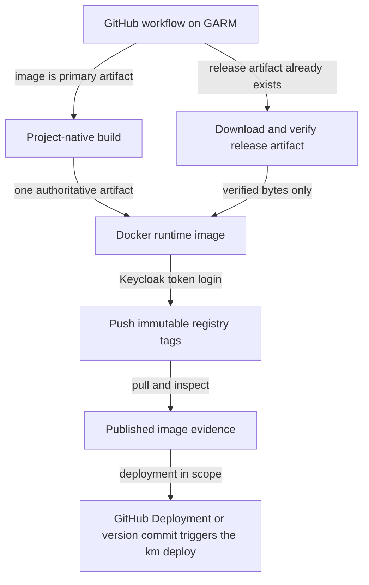

# local-cicd: self-hosted CI/CD 体系

`runner-canary` 是当前 **image-service 样板**，不是所有 GARM 项目的唯一形态。先按项目类型判断，再套对应链路；不要把 registry image、healthz、Komodo DeployStack 强加给 plugin / sync / E2E-only repo。

## Authoritative sources first

Before asserting current state, verify from live/current sources:

1. **Live GARM on VM 181** — repo/pool truth lives in GARM sqlite; read it through the host CLI, whose root profile is restored from the OpenBao `ops` path by `pve-vctcn/apps/runner/scripts/login-garm-admin.sh` (it reads `garm_admin_username`/`garm_admin_password` through `bao-exec` and pipes the password into `garm-cli profile login`; see the runner README "GARM administration"):
   ```sh
   ssh root@vctcn-runner.mouriya.lan '/usr/local/bin/garm-cli pool ls --format json'
   ssh root@vctcn-runner.mouriya.lan '/usr/local/bin/garm-cli repository ls --format json'
   ```
   Never print `garm-cli profile list --format json` (it contains the token).
2. **Runner/registry docs** — `/Users/mouriya/Ext/code/devops/pve-vctcn/apps/runner/README.md`, `/Users/mouriya/Ext/code/devops/pve-vctcn/apps/registry/README.md` (VM, Keycloak, signing keypair, consumer secrets) and `/Users/mouriya/Ext/code/vctcn-edge/stacks/registry/README.md` (registry + docker_auth app).
3. **Consumer repo latest default branch** — fetch/pull latest default branch or inspect `origin/<default>` if the working tree is dirty.
4. **Owning IaC repo** — for placement and install/deploy truth: `homelab-tf` or `pve-vctcn` current docs/state/submodules.

Static lists in this skill are examples/patterns. Treat live GARM + current repo docs as final.

## System boundaries

| Stage | Authority |
|---|---|
| Source repo | App/plugin/sync code, workflow YAML, artifact naming, app-level deploy trigger. |
| Runner seam | One GARM controller on VM 181 `vctcn-runner`, pool state in GARM sqlite (not TF). Each onboarded repo has a resident `lxd_local` pool (LXD on VM 181, mesh via VM 181's NetBird peer) and an edge `incus_edge` pool (Incus on the operator's CachyOS laptop, mesh via that laptop's peer) with the same base labels; a common-label job prefers resident and overflows to edge. An edge pool may additionally carry `cachyos` (pve-vctcn#300), which makes jobs requiring it edge-only. A repo that needs arm64 also gets an `incus_oracle` pool (Incus on Oracle A1, host owned by `oracle-iac`, mesh via that host's peer, always enabled, no gate) labelled only `self-hosted,linux,arm64`. See `pve-vctcn/apps/runner/README.md`. |
| Private registry | `registry.237575.xyz` on VM 182 `vctcn-registry`. The registry + docker_auth Stack (compose, docker_auth config, `ext_auth.sh`) is declared in `vctcn-edge`; VM 182, Keycloak realm `registry` with client and `sa-registry`, the token-signing keypair and the consumer repos' Actions secret are `pve-vctcn/apps/registry`. |
| Komodo deploy | Workload repo declarations, webhook and value workflow, image release triggers, app onboarding: `km` skill. Komodo installation, registry pull account and Core listener ingress: the IaC repo that installs Komodo (`iac-projects`). |
| vctcn hosts and edge | `pve-vctcn`: VMs 180–182, Keycloak, GARM, host NAT/DNAT and Cloudflare DNS. `vctcn-edge`: the edge apps on those hosts and CT 171, including NPM, whose proxy hosts are declared in its compose bootstrap. |

## Decide the CI/CD shape by artifact type

### First decide the build artifact authority

Before writing a Docker workflow, inspect the repo's existing release/build
pipeline and choose exactly one compiler for each released version.

- **Source-built image:** use when the container image is the primary release
  artifact. The Docker build may run the project build once and publish the
  resulting image.
- **Release-artifact image:** use when an existing workflow already publishes
  the executable/package consumed at runtime. That workflow is the sole
  compiler. The image workflow waits for the release artifact, verifies it,
  and only packages it into the runtime image.

Do not rebuild an executable in Docker after its release workflow already compiled it. Verify the release checksum/digest and package those exact bytes; otherwise the same version can name different artifacts.

### A. Image service consumed by Komodo or a host

Use for services like `moat-browser`, `paseo`, and the `runner-canary` sample.



Implementation expectations:

- A release-artifact image should trigger only after the artifact is complete
  (`release: published`, a successful upstream workflow, or an equivalent
  explicit dependency), not race a parallel release job on the same tag.
- Keep compilation and packaging separate: the compiler produces the artifact;
  the runtime Dockerfile copies it and installs only runtime dependencies.
- Runner: `runs-on: [self-hosted, linux, vctcn]` plus `netbird` / `vctcn-runner` / `x64` only when the live pool labels require or clarify capability. These base labels select the repo's pool pair, not resident vs edge: a job may run on either, so it must not depend on `172.16.1.0/24`, a VM 181 source IP, or the VM 181 image cache. A job that needs more memory than VM 181's 4 GiB (shared by all resident runners) adds `cachyos`, which only the repo's edge pool carries once the operator adds it there (today only paseo's); that job runs only on the CachyOS edge host and waits while the edge pool is disabled (pve-vctcn#300).
- arm64 jobs: `runs-on: [self-hosted, linux, arm64]`, only in repos that have an `incus_oracle` pool. That pool never carries `vctcn`, so every x64 job in such a repo must keep `vctcn` in `runs-on`; otherwise it can match the arm64 pool or be handed to an arm64 runner.
- Pool: Docker build/push jobs need `flavor=docker` and VM181 helper-generated `extra_specs` (`build-extra-specs.sh --docker`), identical on the repo's resident and edge pools. A default-flavor pool (e.g. homelab-moat) has no Docker and no registry pin.
- Concurrency: a repo has capacity for at most one resident and one edge job at a time, and the edge half is conditional: the availability gate must have the edge pool enabled, and the edge Incus project allows only **two instances across all repositories**. Every job that writes a shared object (Komodo Stack, floating image tag, release asset, branch) uses a job-level `concurrency` group named after that object, identical across all workflows that write it, with `cancel-in-progress: false`. Use `queue: max` when each run carries its own intent (a release tag, a version to deploy) that must not be dropped; a workflow that only syncs the current default branch may keep the default single pending run, since the newer run supersedes the older one (mouriya-devops/garm-edge-incus#15). actionlint 1.7.12 does not know `queue`; suppress only that diagnostic.
- Registry push: follow [Private registry](#private-registry-registry237575xyz) below. Naming the token action is not enough; the repo must be onboarded to the registry secret first.
- Push immutable tags; add convenience tags only when appropriate (`short-sha`, `latest` on main, release tag, PR tag).
- Deploying to Komodo: release CI holds no Komodo credentials and does not edit Komodo resources, host storage, mesh, placement or the target Core's registry account. When the source repo is separate from the workload repo, the release workflow creates a GitHub Deployment after the last image push (immutable tag first, then the channel tag), using its own `GITHUB_TOKEN` with `permissions: deployments: write`; a deployment-only hook on the source repo runs the workload repo's `deploy-<stack>` Procedure. When the source repo is the workload repo, the release workflow commits the exact version into that Stack's `environment` in the Sync TOML and pushes. The `km` skill's onboarding section owns the Komodo side of both shapes.
- If the service has HTTP semantics, prefer `/healthz` and `/version`; if not, use an equivalent runtime smoke.

Canonical sample docs:

- `/Users/mouriya/Ext/code/devops/runner-canary/README.md`
- `/Users/mouriya/Ext/code/devops/runner-canary/docs/cicd-template.md`
- `/Users/mouriya/Ext/code/devops/runner-canary/komodo/syncs/stacks.toml`
- `/Users/mouriya/Ext/code/devops/runner-canary/stacks/runner-canary/compose.yaml`

### B. Release artifact consumed through the owning deployment workflow

Use when an existing authoritative build publishes a release artifact and checksum for a separate consumer.

- Keep that build as the sole compiler; the consumer verifies and uses the published bytes, without rebuilding the same version.
- Choose the consumer and deployment workflow from the actual project contract; this shape does not imply a particular live workload or deployment endpoint.
- Do not force Docker registry publication or Komodo DeployStack. Normal artifact/version delivery stays with the owning deployment workflow.
- Evidence is the published artifact and checksum plus consumer verification; when deployment is in scope, its owner supplies deployment and runtime evidence.

### C. Komodo workload repo

Use for repos that declare Komodo Stacks (`komodo/syncs/` + `stacks/`), such as `homelab-apps`, `moat-browser-deploy`, `runner-canary` and `homelab-trading`. The repo layout, its ResourceSync, the GitHub webhook to km and the value workflow are defined in the `km` skill's onboarding section; this skill only covers the CI side of that workflow.

CI rules for the declaration workflow:

- It runs on a GARM pool that has `curl` and `jq` (requested through `--extra-packages`, see below), installs `bao-exec` from its latest release through its own `.github/scripts/install-sync-tools.sh` (asset verified against the release's checksum manifest), and needs mesh access to the Core and both OpenBao nodes.
- Authenticate with GitHub OIDC (`permissions: id-token: write`; `BAO_EXEC_AUTH=github-actions`, `BAO_EXEC_ROLE=ci-<owner>-<repo>`) and read the repo's `ci` group plus the Core's `komodo-ci-<core>` path through `bao-exec`. No value file, decrypted copy or repository secret is involved, and the script writes no Komodo Variable; a missing ResourceSync or a resource the CI identity may not write fails the job instead of being created on the fly.
- One job-level `concurrency` group per ResourceSync, `cancel-in-progress: false`.
- Evidence is the `bao-exec` auth/tooling check, the Sync/Procedure API responses, the terminal `RunSync` or declaration Procedure result, the live Stack repo/branch/file path and its `compose_cmd_wrapper`, and a real runtime smoke of the affected app.

### D. GARM-only E2E / notification / runner canary

Use when the repo is not a deployed service, e.g. PR bridge E2E or runner capability checks.

Rules:

- GARM may be required for mesh reachability or parity with production runners.
- No registry or Komodo deploy evidence is required unless the workflow actually publishes/deploys something.
- Evidence is the workflow's target behavior (notification sent, bridge template executed, toolchain check passed, canary HTTP/DNS probe passed).

## When GARM/local-cicd is mandatory

Use GARM or a GARM job for any workflow that must:

- reach `*.mouriya.lan`, NetBird peers, homelab services, Komodo, OpenBao, Step-CA, vctcn registry/NPM/edge, or other private endpoints;
- publish to `registry.237575.xyz` from inside the mesh/private path;
- validate production-like nested Docker runner behavior (resident LXD or edge Incus);
- call Komodo APIs without public ingress;
- prove a release/deploy path that is consumed by homelab/vctcn infra.

A repo may mix runner classes by responsibility. Public/cheap tests can run on cloud runners; mesh/publish/deploy/integration jobs should use GARM.

## GARM onboarding / pool shape

Each onboarded repo gets a GARM repository entity, a resident `lxd_local` pool and an edge `incus_edge` pool with the same base labels and `extra_specs`, plus an optional `incus_oracle` arm64 pool; Docker build/push needs the Docker-capable pool shape. The exact pool shape, how pools are changed live, and the runner environment differences a workflow must tolerate (mesh reachability, registry pin, image cache, preinstalled tools) are in [references/garm-pools.md](references/garm-pools.md). Read it before onboarding a repo or writing a job that depends on runner tools or network.

## Private registry (`registry.237575.xyz`)

Owner: the registry + docker_auth app is `vctcn-edge/stacks/registry`; VM 182, Keycloak realm `registry`, the token-signing keypair and the consumer repos' `KEYCLOAK_REGISTRY_CLIENT_SECRET` are `pve-vctcn/apps/registry`. Read both READMEs ("Authentication flow" in the IaC one) before changing anything here.

### How authentication works

The Docker password is a **Keycloak access token** minted with client_credentials (realm `registry`, client `registry`), never the client secret, and the username is literally `sa-registry`. docker_auth introspects that token on every push and pull scope, so it must still be valid at each of them, not just at login; its lifetime is **1800 seconds** today with no refresh, so use the action's `expires-in` output. The full flow, the runner network path, the Komodo pull side and a failure table are in [references/registry-internals.md](references/registry-internals.md).

### Onboarding a repo that pushes

GARM onboarding does **not** give a repo registry access. First add the repo to the IaC secret sync in `pve-vctcn/apps/registry/variables.tf` (`registry_consumer_repos_mouriya_s_lab` or `registry_consumer_repos` for moat-lab) and apply that workspace; it writes the Actions secret `KEYCLOAK_REGISTRY_CLIENT_SECRET` and keeps it in sync when the client secret rotates. Never set this secret by hand, never put it in a public repo (public source repos publish through a private deploy repo, as moat-browser does through `moat-browser-deploy`).

Workflow step:

```yaml
- id: registry-token
  uses: mouriya-devops/keycloak-token-action@v1
  with:
    keycloak-url: https://keycloak.237575.xyz
    realm: registry
    client-id: registry
    client-secret: ${{ secrets.KEYCLOAK_REGISTRY_CLIENT_SECRET }}
- run: printf '%s' "$TOKEN" | docker login registry.237575.xyz -u sa-registry --password-stdin
  env:
    TOKEN: ${{ steps.registry-token.outputs.access-token }}
```

Place the token step **after** the build and immediately before the first push, so login-to-last-push stays well under the token lifetime. A job with several publish phases separated by long work mints and logs in again before each phase. The action lives at `mouriya-devops/keycloak-token-action`; reference it by that path, since GitHub documents no redirect guarantee for `uses:` after a repository is renamed or transferred.

To check the runner/registry seam without releasing anything, dispatch runner-canary's pull-only canary: `gh workflow run registry-auth.yml -R mouriya-devops/runner-canary`. Its `release.yml` is the full publish example.

## CI/CD 与其他 skill 的分工

- app 的发布与部署（GitHub Deployment 或版本提交触发的部署、Stack 声明、OpenBao 值、RunSync 与声明部署 Procedure）归 workload repo 与 km，见 `km` skill。
- 主机、VM/CT、DNS、mesh、公网入口、根信任、GARM pool 之外的 runner 主机、Komodo 安装，交给 `iac-projects` 定位的 IaC repo；未决设计写清 blocker。
- 给别的 repo 开 issue 时写清已发布的 artifact 和剩余工作；不要让执行方重跑已经自动完成的 build/push/RunSync。

## Evidence matrix

Pick evidence by CI/CD shape:

| Shape | Required evidence |
|---|---|
| Image service | artifact-authority decision; one project build; release checksum/digest match when packaging an existing artifact; Docker build; pushed immutable image; pull/inspect of the pushed digest from the runner; GARM job success; when deploy is in scope, the **target Core's** Compose Pull success for that digest and a run smoke (CI pullback does not prove the target can pull). |
| Release artifact consumption | authoritative build/release success; published artifact + checksum; consumer checksum verification; owning deployment workflow and runtime evidence when deployment is in scope. |
| Komodo workload repo | `bao-exec` auth/tooling check, Sync/Procedure API success, the wrapper present on every Stack that reads a `runtime` path, `RunSync` or declaration Procedure terminal result, Stack repo/branch/file path, runtime smoke of the affected app. |
| E2E-only/canary | Workflow success plus the behavior being tested; no synthetic registry/deploy evidence. |

PR bodies still follow `writing-pr`. If app and infra are split, say exactly which repo owns each evidence layer and link the owning issue/PR.
